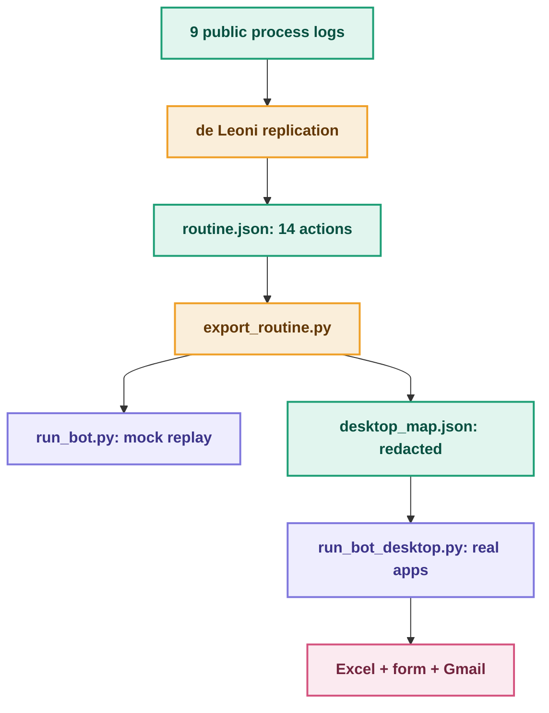
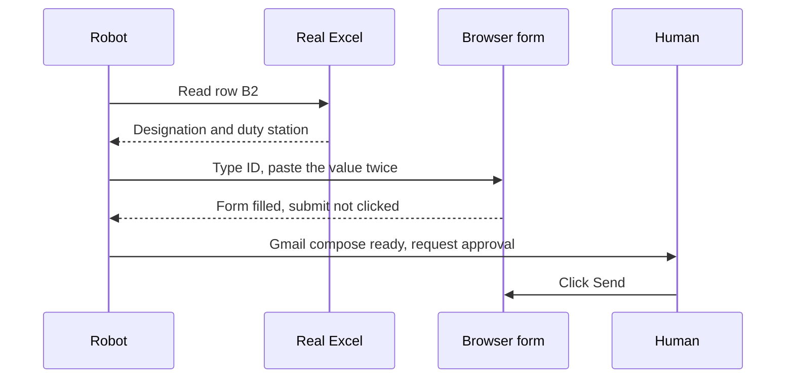

# RPA: Routine Discovery to Robot

A mined routine becomes a robot that clicks real Excel, fills a live form, and sends real email. This is Ishtiaq's slice of the three-person RPA thesis project (Mondira's course), built October to November 2026.

## The pipeline



`label_map.json` translates the discovered log labels to concrete UI targets. The map is keyed by `routine.json` sequence because labels repeat: `copy_B_Excel` occurs at seq 10 AND 12.

## One run, with the safety gate



## Quick start: mock replay

```bash
python3 -m venv .venv && source .venv/bin/activate
pip install -r requirements-demo.txt
python3 -m playwright install chromium
python3 run_bot.py
```

Expected: the 14-action routine replays against `mock_env.html` and the mock page records the actions.

## Desktop demo: real Excel (Windows)

1. Open CMD inside this folder (address bar, type `cmd`, Enter).
2. `python -m venv .venv-win` then `.venv-win\Scripts\activate`
3. `pip install -r requirements-demo.txt`
4. Fill the mail block in `desktop_map.json` with a **demo-only** Gmail account and its 16-character App Password (2FA required). Leaving `PUT-...` keeps the human-click fallback.
5. `python run_bot_desktop.py`

`LAUNCH.sh` and `WINDOWS_OPENCODE_PROMPT.md` are the original runbook material.

## Configuration

| Key | Required | Default | What it does |
|---|---|---|---|
| `mail.smtp_user` | For robot-send | `PUT-DEMO-EMAIL@gmail.com` | Demo-only Gmail account. |
| `mail.smtp_app_password` | For robot-send | `PUT-16-CHAR-APP-PASSWORD` | Gmail App Password. Placeholder means human-click fallback. |
| `mail.to` | Yes | `recipient@example.com` | Recipient for the demo email. |
| `web._url` | Yes | live demo form URL | Target form for Playwright. |
| `cells.audit_col` | Yes | `E` | Column where the robot appends its audit trail. |

No real credentials are committed. If a password was ever used in a live demo, rotate it.

## Receipts

- **9 public process logs** from figshare dataset 12543587.
- **360-row noise grid:** 9 logs x 4 levels x 10 runs.
- **Clean-log Jaccard 1.000** on log 1.
- **14 of 14 actions in 30.9 seconds** in a real browser.
- **Real desktop run:** Excel edits with an audit column appended and SAVED; a real email sent over SMTP.
- Real screenshots in `shots/`: `final.png`, `real_excel_final.png`, `desktop_*.png`.

## Design decisions

- The authors' `functions.py` was never edited. Our runner replays their notebook flow and adapters work around defects in their shipped glue, so every deviation is diffable.
- Real Excel via `win32com` writes into the workbook and saves it. That is persistent evidence, not theater.
- The live form's Submit button is never clicked. The robot hovers with a halo only.
- Robot-send is primary only when a demo SMTP account is configured. Otherwise a human clicks Send.

## Project structure

```text
rpa-routine-to-robot/
├── routine.json           # discovered 14-action program
├── label_map.json         # log labels to UI targets
├── desktop_map.json       # redacted desktop deployment map
├── export_routine.py      # discovery output to action plan
├── run_bot.py             # browser replay against mock_env.html
├── run_bot_desktop.py     # real Excel, form, and Gmail
├── mock_env.html          # offline mock target
├── shots/                 # real run screenshots
└── WINDOWS_OPENCODE_PROMPT.md
```

## Limitations

The U3 auto-delimiter grid on Windows ended in `MemoryError`, so no number from that run is claimed here. The real-Excel path is Windows-only. There are no automated tests and no CI. The upstream replication data is deliberately not included.

## Attribution

Three-person thesis: [@Koushiq-Sourav](https://github.com/Koushiq-Sourav) (Koushiq Chowdhury) did data collection and preprocessing; Sharin Akter Shashi did sessionization, encoding, clustering, and the U2/U3 automation; [@BleedingGpt](https://github.com/BleedingGpt) (Ishtiaq Ahmed) did post-cluster evaluation, the 360-row noise grid, and this routine-to-robot executor.

Base paper: de Leoni et al., COOPIS 2025, DOI 10.1007/978-3-032-15538-2_26. This is a replication and extension, not a copy of their system.
